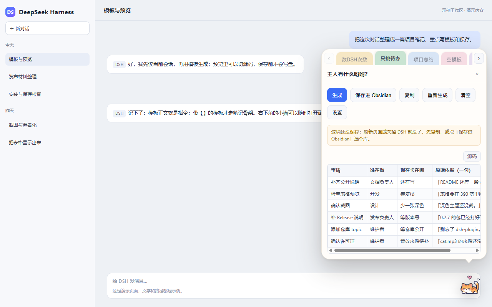
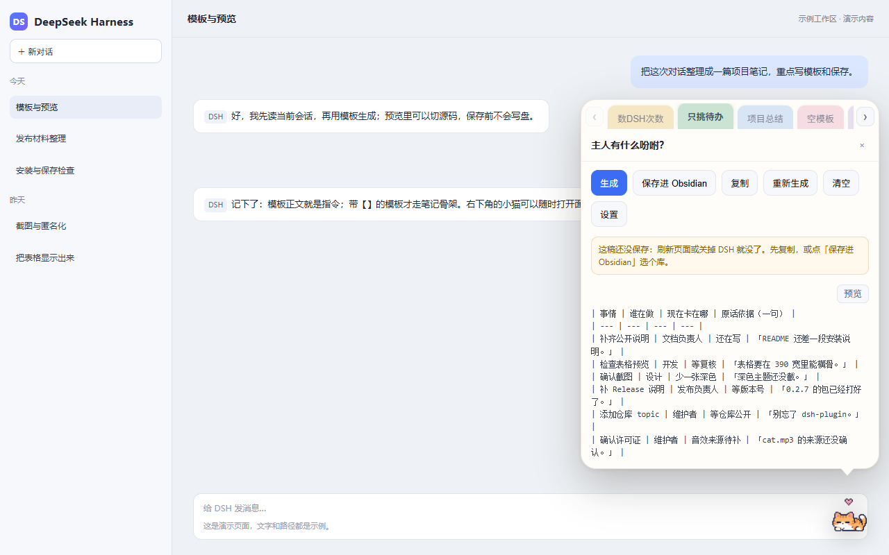
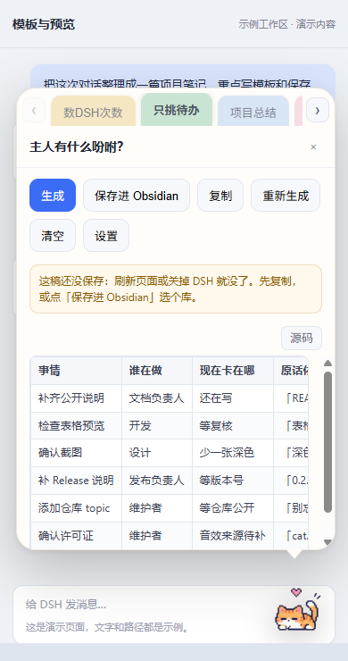

# dsh-session-recap

把 DSH 里的一段对话，按你写的模板生成结果，再存成 Obsidian 笔记。

用法：点右下角的小猫，选模板，生成，预览，保存。没有 Obsidian 库也能先生成、预览、复制；只有保存时才需要选库。



## 它能做什么

模板正文就是给模型的完整指令。你写“数一数 DSH 出现了几次”，它只回次数；写“只挑没做完的事”，它只列待办；模板里带 `【】`，就按笔记骨架填成一篇。

下面按你想让它干的活分类。每条都是模板正文的写法示例，不是内置功能；输出会受对话内容和所用模型影响。

### 数

- 数一数这次对话里出现了几次 `DSH`。只回三行：次数、最多 5 条原话、读取范围。
- 这次对话一共改了哪些文件？只列文件名和出现次数。
- 数一数我明确改过几次要求，按时间顺序列出原话。

### 挑

- 只挑出还没做完或待确认的事。输出表格：事情 | 谁在做 | 现在卡在哪 | 原话依据（一句）。
- 只列我明确改过的要求，不要写你自己的建议。
- 只挑出这次对话里前后矛盾的说法，每处给两条原话。

### 提

- 提取这次对话里的决定、承诺、日期、金额、文件名和命令，分组列成清单。
- 把最后确定的方案和还没定的点分开写。
- 列出这次对话里出现过的所有命令，按先后顺序，保留原始参数。

### 转

- 把这次对话改写成 300 字周报，只写做完的事和下周计划。
- 改写成给同事看的交接说明：背景、当前状态、下一步、需要注意的坑。
- 改写成一条给用户的回复，语气平实，不超过 150 字。

### 评

- 按清晰度、可执行性、风险三个维度各打 1–5 分，每项给一句理由。
- 找出这次对话里最可能被忽略的风险，按严重程度排序。
- 检查前后的说法是否一致，指出矛盾处并给原话。

### 结构化

- 输出 JSON：`decisions[]`、`todos[]`、`files[]`；只输出 JSON。
- 输出 CSV，列：事情,负责人,状态,依据。
- 按时间线列出每一步做了什么、结果是什么，用 Markdown 表格。

Markdown 的表格、标题、列表、引用、代码块会在预览里按原格式显示；JSON、CSV 这类内容建议让模型放进代码围栏，预览会按代码块显示，否则按普通文字显示。

## 安装

### 前提

| 项 | 实测 / 要求 |
|---|---|
| DSH CLI | `0.1.2-rc.1` 实测；其他版本未验证 |
| Node.js | `v24.16.0` 实测；`package.json` 要求 `>=20` |
| 系统 | Windows 11 `10.0.26200` 实测；macOS / Linux 未验证 |
| Obsidian | 可选；没有库也能生成和预览，保存时才需要 |

DSH 目前还是预发布版本，插件通过注入脚本挂到页面上；DSH 大版本升级后可能失效，升级后先刷新页面，仍不对就等插件跟进。

### 安装包

本版**没有发布到 npm**，只以 tarball 分发。到 Release 页下载：

- 文件：`dsh-session-recap-0.2.7.tgz`
- 大小：`476,618` 字节
- SHA-256：`E3056A371E5EA0E616FE525064178102097C0D71B284BF1AD7875CD53C06CD0C`

下载后，在 PowerShell 里用本地路径安装（下面假设 profile 是 `web`、文件在“下载”目录）：

```powershell
dsh plugin --profile web add "$env:USERPROFILE\Downloads\dsh-session-recap-0.2.7.tgz"
```

把 `web` 换成你平时用的 profile；文件不在“下载”目录就换成实际路径。装完重启该 profile（例如关掉再运行 `dsh web`），再刷新页面。

> 本版实测的是“本地 tarball 路径 + `dsh plugin --profile ... add`”。没有实测直接用 https URL 安装，所以上面不写 URL 形式。也不要用 `npm install dsh-session-recap`：这个包还没上 npm。

### 升级

下载新版本的 tarball，用同一条 `add` 命令装新包，重启并刷新页面。升级不会自动迁移你的模板和库路径；配置仍在原来的位置。

### 卸载

```powershell
dsh plugin --profile web remove dsh-session-recap
```

把 `web` 换成你装插件时用的 profile。卸载后重启该 profile。会留下 `~/.dsh/session-recap.json`（模板与库路径）和系统临时目录里的 `dsh-recap.log`；不需要就手动删掉。

## 第一次使用

1. 点右下角的小猫。没配库也能直接用，面板不会自动弹设置。
2. 选一个模板；没有合适的就点「设置」→「编辑」改正文，保存后再选它。
3. 点「生成」，选这次要处理的对话。长对话需要压缩时会先问「只读重点 / 读全部」。
4. 看预览。默认按 Markdown 排版；点右上角「源码」可以看原始 Markdown，再点「预览」切回。
5. 点「复制」拿走原始 Markdown；或点「保存进 Obsidian」。
6. 第一次保存会要求选库：点「自动找我的 Obsidian 库」或手动填路径，选好后关掉设置再点保存。同一稿直接写入，不会重新生成。

保存位置默认是 `库/项目经历/年.月/月.日 项目名/项目名 · 模板名.md`；模板名为空时用会话标题。具体目录可以在设置里改。

## 模板怎么写

模板正文分两种，按正文里有没有 `【】` 自动判断。

### 自由指令（正文不含 `【】`）

正文就是这次任务的完整指令，插件不会在外面再套“请总结这段对话”。最小例子：

```markdown
数一数这次对话里出现了几次 DSH。
只回三行：次数、最多 5 条原话、读取范围。
```

也可以写得更严格：

```markdown
只挑出还没做完或待确认的事，其他一律不写。
输出标准 Markdown 表格，第一行是表头：事情 | 谁在做 | 现在卡在哪 | 原话依据（一句）；第二行是分隔行。
按紧急程度排序，最多 10 行。没有就回一行「没有待办」。
```

### 笔记骨架（正文含 `【】`）

正文里有 `【】` 时，插件按笔记骨架处理，让模型把内容填进骨架。最小例子：

```markdown
# 【标题】

## 要点
- 【填写】

## 结论
- 【填写】
```

两种模式不要混用：正文只要出现 `【】`，就会走笔记骨架。模板名会优先用作文件名；模板名为空时回退会话标题。最多 6 个模板。

## 预览、复制与保存

- **预览**：默认按 Markdown 显示，表格是真正的表格，标题、列表、引用、代码块按原格式排版。宽表格在表格自己那一行里左右滑，不会把整个面板撑宽。
- **源码**：右上角「源码 / 预览」开关。源码态只读显示原始 Markdown，保留空格和换行；切换只改显示，不会重新请求模型。
- **复制**：无论当前是预览还是源码，复制的都是原始 Markdown。
- **保存**：写入的也是原始 Markdown，与当前视图无关。保存前不会写盘；保存失败会保留原稿，可以重试。





## 数据流与权限

| 它会做的事 | 说明 |
|---|---|
| 读会话记录 | 只读当前这次对话的事件日志 |
| 调模型 | 用你 DSH 里当前配置的模型；短对话一次请求，读全部可能分段多次请求；不额外存密钥 |
| 写文件 | 只写你设置的那个库目录，文件名会做安全化处理 |
| 联网 | 除模型调用外不联网；没有遥测 |
| 配置 | 存在 `~/.dsh/session-recap.json`，写入前留一份 `.bak` |
| 日志 | 系统临时目录的 `dsh-recap.log`，只记阶段与错误，不记笔记正文 |

插件只把这次生成的对话材料发给 DSH 当前配置的模型服务；不会上传到别的第三方服务，也没有遥测。只有你点「生成」或「保存」时才动作，不会在后台自动生成。

## 兼容范围（实测）

| 项 | 实测值 |
|---|---|
| DSH CLI | `0.1.2-rc.1` |
| Node.js | `v24.16.0`；`package.json` 要求 `>=20` |
| 系统 | Windows 11，`10.0.26200` |
| 其他系统 | 未验证 |
| 真实 DSH 安装 | 0.2.7 已由作者在 Windows 11 + DSH `0.1.2-rc.1` 安装，验证过表格预览、源码切换、保存进 Obsidian 和计数模板 |
| macOS / Linux | 未验证 |
| npm | 未发布 |

说明：`CHANGELOG.md` 保留 0.2.7 打包时的原始记录；0.2.7 的真实装机结果以本页的兼容范围为准。

## 已知限制

- **注入式挂载**：界面靠注入脚本挂到页面，DSH 大版本升级后可能失效；计划后续迁到客户端插件。
- **单会话**：一次只处理一条对话，不做跨对话的项目级汇总。
- **长对话分段**：会被压缩时先让你选「只读重点 / 读全部」；读全部按时间分段执行同一条指令再合并，仍可能压缩个别措辞，预览上方会如实说明。
- **预览语法范围**：内置轻量 Markdown 渲染，支持表格、标题、列表、引用、代码块、链接等常用语法；脚注、数学公式、Mermaid 等扩展语法按纯文本显示。原始 HTML 只当文字，不执行；远程图片不加载，只显示「图片：alt（url）」。
- **多 profile 共用配置**：配置在 `~/.dsh/session-recap.json`，不在 profile 里；换 profile 仍是同一份库路径与模板。
- **升级后要刷新**：遇到列表拿不到或保存异常，先刷新页面；面板顶部会提示页面与服务端版本不一致。
- **模型输出有波动**：模板是指令，不是确定性程序；同一模板在不同模型、不同对话上可能给出不同格式。要稳定格式，就把表头、列名、行数写清楚。
- **音效版权**：`assets/cat.mp3` 的来源与授权未确认，详见下面的「许可与素材」。

## 卸载与清理

```powershell
dsh plugin --profile web remove dsh-session-recap
```

把 `web` 换成你装插件时用的 profile。重启后猫消失。再删掉：

- `~/.dsh/session-recap.json`（以及同目录的 `.bak`）
- 系统临时目录里的 `dsh-recap.log`

已经写进 Obsidian 的笔记不会自动删除，需要你自己在库里处理。

## 许可与素材

- **代码**：MIT，见 `LICENSE`。
- **图片与动画**（`assets/` 下的四态猫 webp、`cat-idle.png`、`cat-states*.png`、`cat-preview-72.png`）：AI 生成，再经 `scripts/build-cat-assets.mjs` 抠底、统一画布。原始生成文件不随包分发；具体生成工具、原始出处与授权**待补**。
- **音效**（`assets/cat.mp3`）：来自网络的猫叫声，原始链接与授权**未确认、待补**。它不是作者原创，也不按 MIT 授权；在补全来源与许可前，请勿默认可以再分发或商用。公开仓库再分发这个文件有版权风险；如果要更稳妥，可以在自己的副本里删掉或替换它。
- 代码许可与素材来源分开说明，详见 `assets/CREDITS.md`。

## 故障排查

**猫不出现**

- 确认插件装在你正在用的 profile 里，装完重启过 profile，并刷新了页面。
- 打开浏览器控制台看有没有加载错误；DSH 大版本升级后注入挂载可能失效。
- 禁用插件后不重启、等约 5 秒消失的逻辑没有验证；以重启后的结果为准。

**列表拿不到 / 没有可选的对话**

- 当前没有活跃对话时，插件不会猜一条；点「重试」，或先回到要处理的对话再打开面板。
- 列表为空时，确认这条对话还在 DSH 里；必要时刷新页面。

**保存失败**

- 检查库路径是否指向 Obsidian 库根目录（里面应有 `.obsidian`）。
- 检查该目录是否可写；只读库或权限不足会保存失败。
- 保存失败时原稿会保留，修好路径后再点保存即可，不需要重新生成。

**预览里没有表格**

- 先点「源码」看原始 Markdown 里有没有表头行和 `|---|` 分隔行。
- 如果没有，说明模型没有按表格输出：在模板里写清“输出标准 Markdown 表格，第一行表头，第二行分隔行”。
- 如果源码里有、预览里没有，先刷新页面；仍不对就带上截图和 DSH 版本反馈。

**长对话很慢**

- 选「只读重点」会快一些；「读全部」按时间分段执行同一条指令再合并，可能多花 1–3 分钟。
- 同一会话会记住你的选择，设置里可以改默认。

## 仓库

- GitHub：https://github.com/RedoMiao/dsh-session-recap
- Release：https://github.com/RedoMiao/dsh-session-recap/releases/tag/v0.2.7
- 问题与建议：https://github.com/RedoMiao/dsh-session-recap/issues

这个项目目前只在 Windows 11 + DSH `0.1.2-rc.1` 上做过实机验证。其他系统、其他 DSH 版本欢迎反馈，但请先按上面的“未验证”理解。
